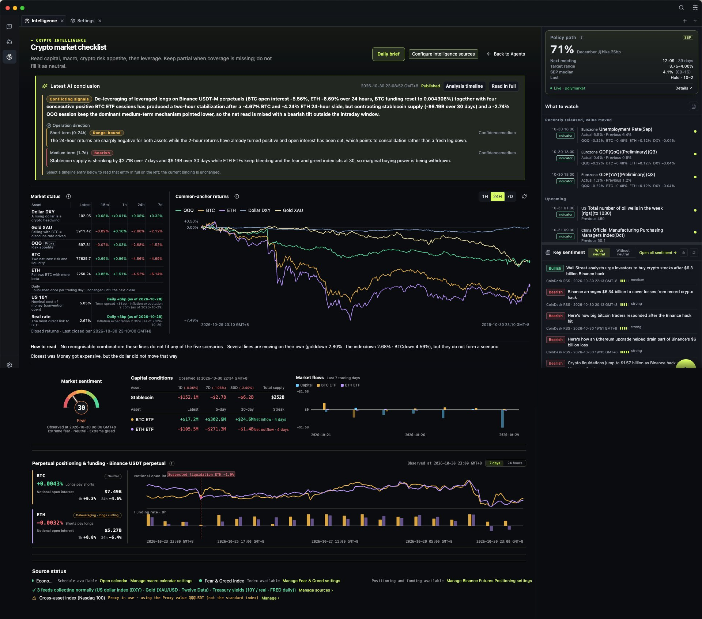

[English](./README.md) | [中文](./README.zh-CN.md)

<p align="center">
  
</p>

<h1 align="center">MacroBay</h1>

<p align="center">
  <strong>Crypto market intelligence with receipts.</strong>
</p>

<p align="center">
  <a href="./LICENSE"></a>
  <a href="./docs/reference/status-and-limitations.md"></a>
  <a href="https://github.com/shawn-tangsc/MacroBay/actions/workflows/ci.yml"></a>
  
</p>

<p align="center">
  <a href="#quick-start">Quick start</a> ·
  <a href="#whats-on-the-desk">What's on the desk</a> ·
  <a href="#why-crypto-first">Why crypto</a> ·
  <a href="#data-sources">Data sources</a> ·
  <a href="#roadmap">Roadmap</a> ·
  <a href="./docs/README.md">Docs</a> ·
  <a href="./LICENSE">License</a>
</p>

<p align="center">
  <sub>Local-first. No bundled market data, no bundled API keys, no hosted account. Not affiliated with any venue or data provider.</sub>
</p>

---

MacroBay is a desktop intelligence desk for crypto. One screen holds what actually moves the market —
perpetual funding and positioning, stablecoin supply and ETF flows, risk appetite, cross-asset moves,
and the macro prints that reprice everything. The analyst agent reads the same evidence and explains
what changed, with the source and the cutoff time attached to every number.

A claim that cannot be traced to a source record and a timestamp is supposed to be reported as a gap.
That is the whole product: **not a paragraph you have to take on faith.**

<p align="center">
  
</p>

<p align="center">
  <sub>The whole desk on one page — AI conclusion, market status, cross-asset returns, capital conditions, sentiment and funding. <a href="./docs/assets/screenshots/demo-en.gif">Watch the 38-second demo</a>.</sub>
</p>

## Download

**[macOS · Apple Silicon (.dmg)](https://github.com/shawn-tangsc/MacroBay/releases/latest/download/MacroBay-arm64.dmg)** ·
**[Windows · x64 (.exe)](https://github.com/shawn-tangsc/MacroBay/releases/latest/download/MacroBay-x64-setup.exe)** ·
[All releases](https://github.com/shawn-tangsc/MacroBay/releases)

The build is unsigned. On macOS, right-click the app → **Open**, or run
`xattr -dr com.apple.quarantine /Applications/MacroBay.app`. On Windows, choose
**More info → Run anyway** in the SmartScreen prompt.

**No API key yet?** Open the app and choose **Sample mode → Open sample dashboard**. It replays one
recorded real week — dashboard, funding, stablecoins, ETF flows, two calendar months and three
published analyses — labelled *Sample data*, and writes nothing into your database. Live panels still
need your own model provider and data-source credentials.

Built for people whose read has to survive a follow-up question — whether that is your first cycle or your fourth.

## Who it is for

- **[Trading for a living →](./docs/product/for-professionals.md)** — one screen instead of five, and a
  conclusion that survives "how do you know?".
- **[Still learning the market →](./docs/product/for-newcomers.md)** — the same screen, except it
  explains the plumbing while you read it.

## Why crypto first

Crypto is the hardest place to fake a market read, which makes it the right place to build one.

- **The market never closes.** Funding flips at 00:00 UTC, a listing lands at 3am, CPI prints
  mid-session. There is no closing bell that consolidates the story, so the timestamp and the source
  *are* the analysis.
- **The signal is scattered.** Exchange announcements and API changes, status incidents, stablecoin
  supply, ETF flows, funding, sentiment, macro releases — no single feed tells you what changed.
- **Revisions are quiet.** A number you read yesterday may be restated today. A tool that overwrites
  the old reading removes the only way to learn from being wrong.

So the desk is built around three habits: read the whole picture on one screen, keep the observation
time on every reading, and make the AI show its work.

## What's on the desk

- **Funding and positioning.** BTC and ETH perpetual funding, who pays whom, and the history behind
  today's print instead of a single number.
- **Capital and flows.** Stablecoin supply and ETF net flows — the liquidity that has to be
  somewhere.
- **Risk appetite.** The Fear & Greed index read as evidence, with its observation time and bucket,
  not as a verdict.
- **Cross-asset, one scale.** DXY, gold, QQQ, US10Y, BTC and ETH normalized on a single chart.
- **A calendar that does not rewrite history.** Scheduled, observed, and later-revised values are
  separate records — FOMC, CPI, PCE and payrolls with their official release values.
- **Venue and chain events.** Binance and OKX announcements and API changes, plus Coinbase, Kraken
  and Solana status.
- **An analyst with a visible trace.** It reads the same evidence, separates facts from assumptions,
  asks a structured question when a choice changes the answer, and shows the tools it ran.

## Reading it teaches you the market

Most crypto tools assume you already know why funding matters. Here the explanation sits next to the
number: the key readings carry a plain-language note about what they mean, and every conclusion
spells out the causal chain, the conditions that would break it, and the gaps.

That is the part a newcomer usually has to assemble from ten threads and a group chat: what moved
price, through which channel, and what would prove it wrong. Read a few of those and the market stops
being a black box — you are no longer memorising indicators, you are watching cause and effect with
the receipts attached. One reading gives you a number; the next tells you the channel it works
through — after a few, you can explain the move yourself.

It is not a course, and it is not advice. It is a desk that lays out its reasoning every time you
open it.

## How a complete answer looks

Every analysis separates five things, or it is incomplete:

| Element | What it means |
| --- | --- |
| **Facts** | Observed values, each tied to a source record |
| **Assumptions** | What the interpretation takes for granted |
| **Conditions** | What would invalidate the conclusion |
| **Gaps** | What the available evidence does not answer |
| **Time boundary** | The observation time, and the `asOf` cutoff the query used |

A later revision is not folded back into an earlier answer. Reading the market at 09:00 and reading
it at 21:00 should produce two different, defensible answers — not one answer silently rewritten.

## What it is not

- **Not a signal service.** No buy or sell calls, no return promises, no "alpha" for sale.
- **Not a trading bot.** No order execution, no position management, no brokerage connection.
- **Not a hosted account.** No MacroBay server holds your data or your keys; there is nothing to sign
  up for and nothing to cancel.
- **Not a data bundle.** No bundled feeds and no bundled credentials — you enable the sources you
  have access to.

## Data sources

30+ curated sources, chosen because crypto is where free and low-cost data is actually good enough:
exchange announcements and API changes (Binance, OKX), venue, chain status and release feeds
(Coinbase, Kraken, Solana, GitHub releases), market data (Binance spot and futures, CoinGecko,
DeFiLlama stablecoins and TVL, ETF flows, Fear & Greed), news and calendars (CoinDesk, CryptoPanic,
CoinMarketCal, Ethereum Foundation), and the macro layer that sets the regime (FRED, BLS, BEA,
Treasury, SEC, CFTC, Federal Reserve).

Some sources need your own account, key, or network access, and coverage varies by source. Anything
you have not enabled appears as an explicit gap — never as a neutral placeholder value.

## Quick start

Prefer a build? Grab a [release](https://github.com/shawn-tangsc/MacroBay/releases). To run from
source you need **Node.js 22+** and **pnpm 10**; to build the package yourself, use `pnpm dist:mac`
(see [Packaging](./docs/development/packaging.md)).

```bash
pnpm install
pnpm dev
```

Full walkthrough: **[Quick start](./docs/getting-started/quick-start.md)**.

1. **Settings → Model Service**: add a provider and API key, enable it, and choose the default model
   for agents.
2. **Settings → Intelligence Sources**: enable the sources you have access to and add any required
   credentials.
3. Open the **intelligence portal** → **Crypto Market Analyst** → **Open dashboard**.
4. Ask the analyst: *What changed in the last macro release, and which assets does it affect?*

The answer should show what is known, what is missing, where the evidence came from, and the time
boundary it used.

## Status

MacroBay is **alpha** (`0.2.2`). macOS is the verified platform. A **sample mode** ships with the app:
with no key and no network you can open the full dashboard and one published analysis, replayed from a
real recorded week. Live panels still need your own provider credentials. The macOS `.dmg` is unsigned;
Windows installers build in CI and on Windows 11 x64 hardware, but the installed app is not verified
there yet, and Linux has no packaging. See [Status and limitations](./docs/reference/status-and-limitations.md).

## Roadmap

Crypto depth comes first: more venues and derivatives coverage, ETF and flow history, on-chain
signals, and event-driven alerts. Review and replay make a decision inspectable after the fact.
The runtime stays model- and agent-replaceable so the desk can deepen without becoming a monolith.
See [ROADMAP.md](./ROADMAP.md).

## Documentation

| Start | Understand the product | Build on it |
| --- | --- | --- |
| [Quick start](./docs/getting-started/quick-start.md) | [Product overview](./docs/product/overview.md) | [Architecture](./docs/platform/architecture.md) |
| [Installation](./docs/getting-started/installation.md) | [Analysis workflow](./docs/product/analysis-workflow.md) | [Development setup](./docs/development/setup.md) |
| [First run](./docs/getting-started/first-run.md) | [Traceability](./docs/product/traceability.md) | [Adding a product](./docs/development/adding-a-product.md) |
| [Model service](./docs/getting-started/model-service.md) | [Analyst agent](./docs/product/analyst-agent.md) | [Platform and products](./docs/platform/platform-and-products.md) |
| [Status and limitations](./docs/reference/status-and-limitations.md) | — | — |

Chinese documentation: [docs/README.zh-CN.md](./docs/README.zh-CN.md)

## Data and privacy

MacroBay is a client for providers you configure. The MIT license covers the code, not the data.
There is no MacroBay-hosted data service, no resale, and no proxy: your data stays on your machine
and credentials stay in the local secret store. You are responsible for provider terms, keys, rate
limits, and any commercial use.

[Data and third-party services](./docs/reference/data-disclaimer.md)

## Feedback

Questions about setup, data sources or proxies belong in **Q&A**:
[ask there](https://github.com/shawn-tangsc/MacroBay/discussions/new?category=q-a) rather than in an
issue. Bugs and concrete feature requests go through the issue templates.

Early feedback shapes the roadmap directly: what gets added, and what gets dropped.

## Contributing

- [Contributing guide](./CONTRIBUTING.md)
- [Security policy](./SECURITY.md)
- [Code of conduct](./CODE_OF_CONDUCT.md)

Electron 41 · React 19 · TypeScript 5.8 · pnpm 10. Local AI development notes may live in
`AGENTS.md`; that file is not part of the public repository.

## License

[MIT](./LICENSE) © 2026 MacroBay contributors
