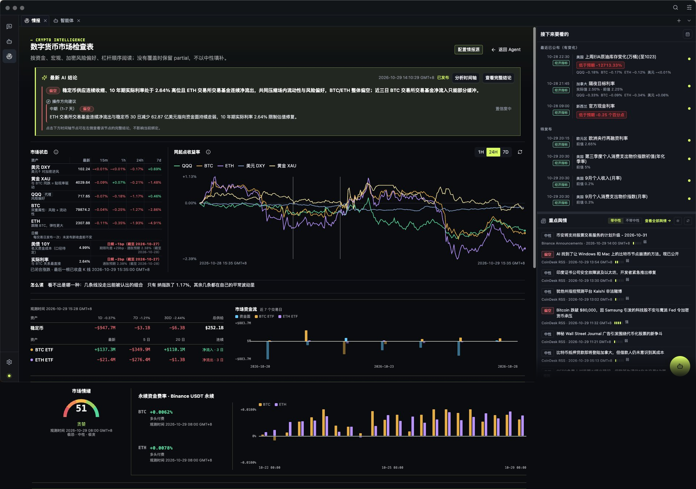

[English](./README.md) | [中文](./README.zh-CN.md)

<p align="center">
  
</p>

<h1 align="center">MacroBay 观潮</h1>

<p align="center">
  <strong>加密市场情报，每条都有出处。</strong>
</p>

<p align="center">
  <a href="./LICENSE"></a>
  <a href="./docs/reference/status-and-limitations.md"></a>
  <a href="https://github.com/shawn-tangsc/MacroBay/actions/workflows/ci.yml"></a>
  
</p>

<p align="center">
  <a href="#快速开始">快速开始</a> ·
  <a href="#看板上有什么">看板上有什么</a> ·
  <a href="#为什么从加密开始">为什么是加密</a> ·
  <a href="#数据来源">数据来源</a> ·
  <a href="#路线图">路线图</a> ·
  <a href="./docs/README.zh-CN.md">文档</a> ·
  <a href="./LICENSE">许可证</a>
</p>

<p align="center">
  <sub>本地优先。不内置行情数据，不内置 API Key，没有托管账号。与任何交易所或数据供应商均无附属关系。</sub>
</p>

---

MacroBay 观潮 是一张给加密市场的桌面情报台。一屏之内，是真正推动价格的那些东西：永续资金费率与
持仓、稳定币供应与 ETF 流向、风险偏好、跨资产走势，以及会把一切重新定价的宏观数据。分析智能体
读的是同一批证据，它解释"发生了什么变化"，而每个数字都带着来源和截止时间。

追不到来源记录和时间戳的结论，就应该被报告成缺口。这就是整个产品：**不是一个只能凭信任接受的一段话。**

<p align="center">
  
</p>

<p align="center">
  <sub>一屏看完——AI 结论、市场状态、跨资产收益、资金面、情绪与资金费率。 <a href="./docs/assets/screenshots/demo-en.gif">看 38 秒演示</a>。</sub>
</p>

给那些"说完一句话还得接得住追问"的人——不管这是你的第一轮周期，还是第四轮。

## 这套东西适合谁

- **[靠这个吃饭的人 →](./docs/product/for-professionals.zh-CN.md)** —— 一屏替掉五个标签页，结论经得起
  一句"你怎么知道"。
- **[还在学这个市场的人 →](./docs/product/for-newcomers.zh-CN.md)** —— 同一块看板，只是它会一边让你看，
  一边把底下的水管讲清楚。

## 为什么从加密开始

加密是最难糊弄的市场读法，所以也是最值得把读法做对的地方。

- **这个市场没有收盘。** 资金费率在 UTC 0 点翻面，公告在凌晨三点落地，CPI 在盘中公布。没有
  收盘价替你把故事收敛，于是时间和来源本身，就是分析的一部分。
- **信号是散的。** 交易所公告与 API 变更、系统故障、稳定币供应、ETF 流向、资金费率、情绪、
  宏观数据——没有任何一个单一信息源能告诉你"什么变了"。
- **修订是静默的。** 昨天读到的数字今天可能被改写。如果工具直接覆盖旧读数，你就丢掉了从判断
  错误里学习的唯一线索。

所以这张情报台有三个习惯：一屏看完，每条读数留时间，让 AI 交代它是怎么得出结论的。

## 看板上有什么

- **资金费率与持仓。** BTC、ETH 永续合约的资金费率，谁付钱给谁，以及今天这个数字背后的历史，
  而不是一个孤零零的报价。
- **资金与流向。** 稳定币供应与 ETF 净流入流出——流动性总得待在某处。
- **风险偏好。** 恐惧贪婪指数被当成证据来读：带观测时间和所处区间，而不是一句判决。
- **跨资产，同一把尺。** DXY、黄金、QQQ、美债 10 年期、BTC、ETH 归一化到同一张图上。
- **不改写历史的日历。** 计划发布值、实际观测值、后续修订值是彼此独立的记录——FOMC、CPI、
  PCE、非农都带官方发布值。
- **交易所与链上事件。** Binance、OKX 的公告与 API 变更，以及 Coinbase、Kraken、Solana 的
  运行状态。
- **工作过程可见的分析智能体。** 它读同一批证据，把事实和假设分开，在某个选择会改变结论时提出
  结构化问题，并展示它调用过的工具。

## 看得多了，底层逻辑就通了

多数工具默认你已经知道"资金费率为什么重要"。这里，解释就写在数字旁边：关键读数都有一句白话说明
它意味着什么，每条结论都把因果链、成立条件和缺口摊开。

这正是新手过去要靠十篇推文加一个群才能拼出来的东西：价格为什么动、通过哪个渠道动、什么情况会
证明它错了。看上几次，黑箱就变成了因果——你不需要先背二十个指标，你在看的是钱为什么这样流，
而且每一步都有出处。一条读数只给你一个数字，下一条会告诉你它通过哪个渠道起作用——看过几条，你
自己就能把这段行情讲清楚。

它不是课程，也不是建议。只是一个每次打开都把推理过程摆出来的台子。

## 一次合格的回答长什么样

每份分析都要把五件事分开写，缺一不可：

| 组成 | 含义 |
| --- | --- |
| **事实** | 观测到的数值，逐条绑定到来源记录 |
| **假设** | 这次解读默认成立的前提 |
| **条件** | 什么情况下结论会失效 |
| **缺口** | 现有证据回答不了的部分 |
| **时间边界** | 观测时间，以及查询使用的 `asOf` 截止点 |

后来的修订不会被回填进更早的答案。9 点读一次市场、21 点再读一次，应该是两个不同且都站得住的
答案——而不是一个被悄悄改写的答案。

## 它不是什么

- **不是喊单服务。** 不给买卖点，不承诺收益，不卖"alpha"。
- **不是交易机器人。** 不下单，不管仓位，不连券商或交易所账户。
- **不是托管账号。** 没有 MacroBay 服务器保存你的数据或密钥；没有注册，也没有取消订阅。
- **不是数据包。** 不内置行情源，也不内置任何凭证——你有权限访问哪些来源，就启用哪些。

## 数据来源

30 多个经过筛选的来源，选它们的理由很简单：加密恰好是免费和低成本数据足够好的领域。交易所
公告与 API 变更（Binance、OKX）、交易所与链的状态和发布（Coinbase、Kraken、Solana、GitHub
Releases）、市场数据（Binance 现货与合约、CoinGecko、DeFiLlama 稳定币与 TVL、ETF 流向、
恐惧贪婪指数）、新闻与日历（CoinDesk、CryptoPanic、CoinMarketCal、Ethereum Foundation），
以及决定大类资产环境的宏观层（FRED、BLS、BEA、Treasury、SEC、CFTC、美联储）。

部分来源需要你自己的账号、Key 或网络访问，覆盖范围也因来源而异。没有启用的来源会以明确的缺口
呈现，绝不会被填成一个中性的占位值。

## 快速开始

需要 **Node.js 22+** 和 **pnpm 10**。用 `pnpm dev` 从源码运行，或用 `pnpm dist:mac` 打出未签名的
macOS 安装包（见[打包](./docs/development/packaging.zh-CN.md)）。

```bash
pnpm install
pnpm dev
```

完整步骤：**[快速开始](./docs/getting-started/quick-start.zh-CN.md)**。

1. **设置 → 模型服务**：添加一个供应商和 API Key，启用它，并为智能体选择默认模型。
2. **设置 → 情报源**：启用你有权限访问的来源，需要凭据的填入凭据。
3. 打开**情报门户** → **数字货币市场解读员** → **打开看板**。
4. 向分析智能体提问：*最近一次宏观数据发布有什么变化，会影响哪些资产？*

答案应当说明哪些已知、哪些缺失、证据来自哪里，以及它使用的截止时间。

## 状态

MacroBay 目前是 **alpha**（`0.2.1`）。macOS 是已验证平台。应用内置**示例模式**：无 Key、断网也能
打开完整看板并读到三条已发布结论，数据来自真实录制的一周。实时面板仍需你自己的供应商凭据。
macOS 安装包可从源码构建但未签名，Windows 安装器能在 CI 和 Windows 11 x64 真机上构建，但安装后的
运行态尚未验证，Linux 尚未配置打包。详见
[状态与限制](./docs/reference/status-and-limitations.zh-CN.md)。

## 路线图

优先做加密纵深：更多交易所与衍生品覆盖、ETF 与资金流历史、链上信号、事件驱动的告警；复盘与
回放让一个判断在事后仍然可以被检查。运行时保持模型与智能体可替换，这样情报台可以持续加深，
而不会长成一块铁板。详见 [ROADMAP.md](./ROADMAP.md)。

## 文档

| 上手 | 理解产品 | 在此基础上构建 |
| --- | --- | --- |
| [快速开始](./docs/getting-started/quick-start.zh-CN.md) | [产品概览](./docs/product/overview.zh-CN.md) | [架构](./docs/platform/architecture.zh-CN.md) |
| [安装](./docs/getting-started/installation.zh-CN.md) | [分析流程](./docs/product/analysis-workflow.zh-CN.md) | [开发环境](./docs/development/setup.zh-CN.md) |
| [首次运行](./docs/getting-started/first-run.zh-CN.md) | [可追溯性](./docs/product/traceability.zh-CN.md) | [新增产品模块](./docs/development/adding-a-product.zh-CN.md) |
| [模型服务](./docs/getting-started/model-service.zh-CN.md) | [分析智能体](./docs/product/analyst-agent.zh-CN.md) | [平台与产品模块](./docs/platform/platform-and-products.zh-CN.md) |
| [状态与限制](./docs/reference/status-and-limitations.zh-CN.md) | — | — |

English documentation: [docs/README.md](./docs/README.md)

## 数据与隐私

MacroBay 是你所配置供应商的客户端。MIT 许可证覆盖代码，不覆盖数据。没有 MacroBay 托管的数据
服务，没有转售，也没有代理：数据留在你的机器上，密钥留在本地密钥存储里。供应商条款、密钥、
速率限制以及任何商业用途由你负责。

[数据与第三方服务](./docs/reference/data-disclaimer.zh-CN.md)

## 反馈

欢迎提交 Bug、数据源需求和功能想法——开一个 issue 就行。早期的反馈会直接改变路线图：加什么，
以及砍什么。

## 参与贡献

- [贡献指南](./CONTRIBUTING.md)
- [安全策略](./SECURITY.md)
- [行为准则](./CODE_OF_CONDUCT.md)

Electron 41 · React 19 · TypeScript 5.8 · pnpm 10。本地 AI 开发笔记可能放在 `AGENTS.md`；
该文件不属于公开仓库的一部分。

## 许可证

[MIT](./LICENSE) © 2026 MacroBay contributors
