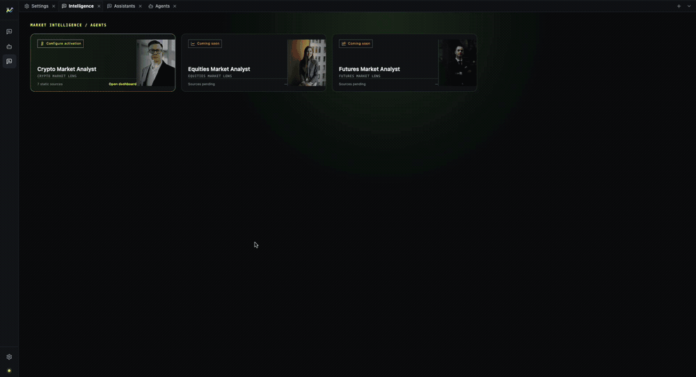

[English](./README.md) | [中文](./README.zh-CN.md)

# MacroBay

**Turn market information into analysis you can check.**



MacroBay is a local desktop app for reading markets with evidence. Open the dashboard, ask the
analyst agent what changed, and see the source and time boundary behind each number. It is not a
chat window that summarizes headlines without receipts.

The project is under active iteration. New AI capabilities and deeper investment-intelligence
coverage are part of the roadmap, not a one-off release.

## Try it in three minutes

```bash
pnpm install
pnpm dev
```

Full walkthrough: **[Quick start](./getting-started/quick-start.md)**.

1. **Settings → Model Service**: add a provider and its API key, enable it, and choose the default
   model for agents.
2. **Settings → Intelligence Sources**: enable the sources you have access to and add any required
   credentials.
3. Open the **intelligence portal** → **Crypto Market Analyst** → **Open dashboard**.
4. Ask the analyst agent a question, for example: *What changed in the last macro release, and
   which assets does it affect?*

The answer should show what is known, what is missing, where the evidence came from, and the time
boundary it used.

## What you can do

- **Read the market picture** — a dashboard with macro context, cross-asset observations, capital
  conditions, and the latest published analysis.
- **Ask why** — the analyst agent reads the same evidence and explains what changed, instead of
  producing an untraceable summary.
- **Check the number** — open the evidence behind a reading and see its source and observation
  boundary.
- **Follow a scheduled event** — the macro calendar keeps releases, revisions, and the cutoff time distinct.

## Data sources

The source catalog is curated rather than tied to one feed. It brings together a range of free and
low-cost platform integrations; enable only the sources you need. Some require your own account, API
key, or network access, and coverage varies by source.

## What an answer looks like

A useful answer separates four things:

```text
Facts        what the source actually says
Assumptions what the interpretation takes for granted
Conditions  what would change the conclusion
Gaps        what the available evidence cannot answer
```

It also states the **cutoff time** up to which the analysis is valid. If a later revision exists, a
historical answer does not silently use it.

## What it is not

- Not a trading bot, and it does not place orders.
- Not unconditional investment advice.
- Not a hosted service: data and credentials stay on your machine.
- Not a source of market data: bring your own provider and data-source credentials.

## Data and third-party services

The MIT license covers the code, not market data or provider content. MacroBay does not resell,
host, or proxy third-party data. Your use of a provider is governed by that provider's terms.

[Data and third-party services](./reference/data-disclaimer.md)

## Feedback

Issues and feature requests are welcome. Open an issue on the repository; feedback directly shapes
the roadmap.

## Current status

The app runs from source. Packaged installers, a demo dataset, and channel integrations are not
part of this release. See [Status and limitations](./reference/status-and-limitations.md).

## Documentation

- [Quick start](./getting-started/quick-start.md)
- [Installation](./getting-started/installation.md)
- [First run](./getting-started/first-run.md)
- [Product overview](./product/overview.md)
- [Analysis workflow](./product/analysis-workflow.md)
- [Traceability](./product/traceability.md)
- [Analyst agent](./product/analyst-agent.md)
- [Architecture](./platform/architecture.md)
- [Roadmap](../ROADMAP.md)
- [Git workflow](./development/git-workflow.md)

## License

[MIT](../LICENSE) © 2026 MacroBay contributors
