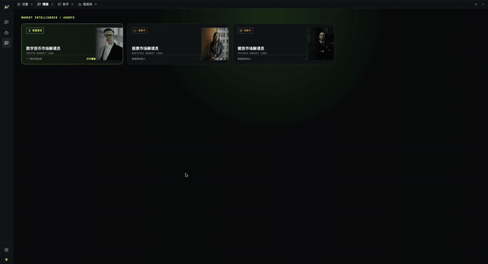

[English](./README.md) | [中文](./README.zh-CN.md)

# MacroBay 观潮

**把市场情报变成可以核对的分析。**



MacroBay 是一个本地桌面应用：打开看板，问分析智能体“最近发生了什么”，然后查看每个数字背后的
来源和截止时间。它不是把新闻丢给模型、再生成一段没有依据的总结。

这个项目会持续迭代：新的 AI 能力和更深的投资情报覆盖是路线图的一部分，不是一次性 demo。

## 三分钟跑起来

```bash
pnpm install
pnpm dev
```

完整步骤见：**[快速开始](./getting-started/quick-start.zh-CN.md)**。

1. **设置 → 模型服务**：添加供应商和 API Key，启用，并选择**智能体默认模型**。
2. **设置 → 情报源**：启用你能访问的来源，需要凭据的填入凭据。
3. 打开**情报门户** → **数字货币市场解读员** → **打开看板**。
4. 问分析智能体一个问题，例如：**“最近这组宏观数据变化了什么？会影响哪些资产？”**

部分信息源对网络环境有要求；如果来源已启用但面板一直为空，先检查网络和代理设置。

答案里应该能看出：已知什么、缺什么、证据来自哪里、截至什么时间。

## 你能用它做什么

- **看市场画面**：看板把宏观背景、跨资产观察、资金条件和最新分析放在一起。
- **追问原因**：分析智能体读取同一批证据，解释变化，而不是给一段无法核对的总结。
- **核对数字**：打开一个读数背后的证据，查看来源和观测边界。
- **跟踪日程事件**：宏观日历区分发布、修订和截止时间。

## 数据源

情报源是筛选过的，不绑定单一数据供应商：目录里有多种**免费或低成本平台**的接入，按需启用即可。
部分来源需要你自己的账号、API Key 或网络环境，不同来源的覆盖范围也不一样。

## 一个答案应该长什么样

有用的分析会把四件事分开：

```text
事实    来源实际说了什么
假设    解读默认成立的前提
条件    什么情况下结论会改变
缺口    现有证据回答不了什么
```

同时说明**截至什么时候**有效。如果之后出现了修订，历史答案不会偷偷使用新版本。

## 它不是什么

- 不是交易机器人，不会下单。
- 不提供无条件的投资建议。
- 不是托管服务：数据和凭据留在本机。
- 不内置行情数据：供应商和数据源凭据由用户自己配置。

## 数据与第三方服务

MIT 许可证只覆盖代码，不覆盖行情数据或供应商内容。MacroBay 不转售、不托管、不代理第三方数据；
你对供应商的使用受该供应商条款约束。

[数据与第三方服务](./reference/data-disclaimer.zh-CN.md)

## 反馈

欢迎在仓库的 Issues 里提问题、数据源建议和功能请求；这些反馈会直接影响路线图。

## 当前状态

应用可以从源码运行。安装包、demo 数据和渠道集成不在本版本范围内。参见
[状态与限制](./reference/status-and-limitations.zh-CN.md)。

## 文档

- [快速开始](./getting-started/quick-start.zh-CN.md)
- [安装](./getting-started/installation.zh-CN.md)
- [第一次运行](./getting-started/first-run.zh-CN.md)
- [产品概览](./product/overview.zh-CN.md)
- [分析流程](./product/analysis-workflow.zh-CN.md)
- [可追溯性](./product/traceability.zh-CN.md)
- [分析智能体](./product/analyst-agent.zh-CN.md)
- [架构](./platform/architecture.zh-CN.md)
- [路线图](../ROADMAP.zh-CN.md)
- [Git 工作流](./development/git-workflow.zh-CN.md)

## 许可证

[MIT](../LICENSE) © 2026 MacroBay contributors
