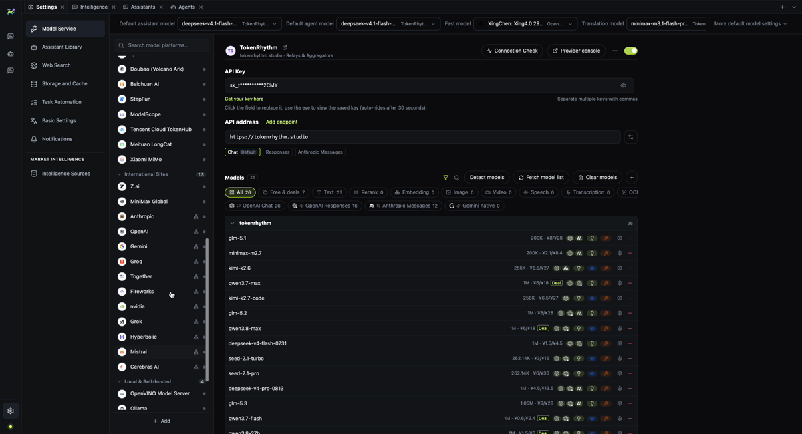

[English](./first-run.md) | [中文](./first-run.zh-CN.md)

# First run

This walkthrough takes a fresh checkout to a working agent conversation. You need a model provider
account and an API key, plus at least one intelligence source you can enable.

## 1. Start the app

```bash
pnpm dev
```

If the window opens on the intelligence portal, that is expected: the product shell and the
agent workspace are separate tabs.


## 2. Configure the model service

Open **Settings → Model Service**.

1. Pick a provider, or add a custom provider if your service is not listed.
2. Enter the API key.
3. Enable the provider.
4. Make sure the provider reports a usable endpoint for the protocol you intend to use.
5. Select a default model for **agents** and, if you use the assistant page, for **assistants**.

The renderer only receives `hasApiKey` and a masked preview after saving. The raw key stays in the
main process and the platform secret store.



### If the page says the model service is not ready

The message names the reason. The common ones are:

- **No default model** — choose one under Model Service.
- **Provider missing** — the model points at a provider that is no longer present.
- **Provider disabled** — enable it again.
- **Missing API key** — save the key for that provider.
- **Model not enabled** — add or enable the model in the provider's model list.

## 3. Start an agent session

Open **Agents**, choose the agent and the default workspace, then send a message.

The first turn may take longer while the runtime starts. Tool calls that need confirmation appear
as approval rows; when the agent asks a structured question, answer it in the question card rather
than typing JSON.

## 4. What to expect from the first analysis

Market intelligence reads registered evidence and publishes a conditional analysis. It does not
give unconditional buy/sell advice. The answer should identify:

- what is known and what is missing;
- the observation time and `asOf` boundary;
- the source evidence behind a reading;
- the conditions under which a scenario would change.

If those elements are absent, treat the output as incomplete rather than authoritative.

## 5. Where data lives

MacroBay stores its local data under the Electron `userData` directory:

```text
macOS:     ~/Library/Application Support/MacroBay
Windows:   %APPDATA%/MacroBay
Linux:     ~/.config/MacroBay
```

Back up that directory if you want to preserve conversations, settings, and source records. Never
commit it to a repository.

## Next

- [Model service](./model-service.md)
- [Product overview](../product/overview.md)
- [Status and limitations](../reference/status-and-limitations.md)
