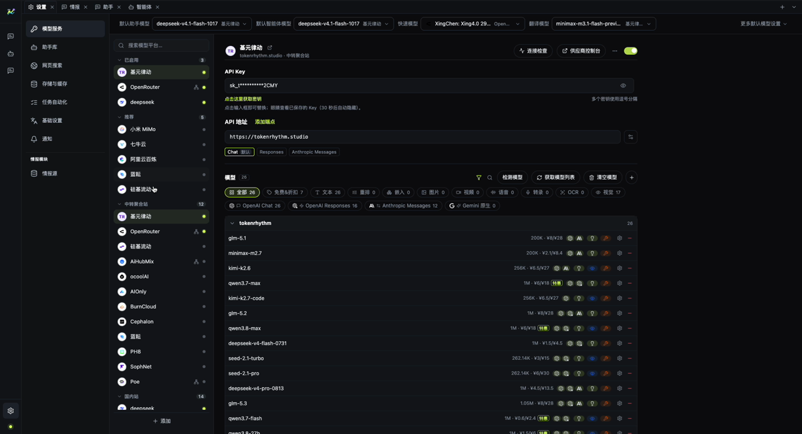

[English](./first-run.md) | [中文](./first-run.zh-CN.md)

# 第一次运行

本文从一份全新 checkout 走到可用的智能体对话。开始前需要一个模型供应商账号和 API Key，
以及至少一个你能启用的情报源。

## 1. 启动应用

```bash
pnpm dev
```

如果窗口打开在情报门户，这是正常的：产品 shell 和智能体工作区是两个独立标签页。


## 2. 配置模型服务

打开 **设置 → 模型服务**。

1. 选择一个供应商；列表里没有的服务可以手动添加自定义供应商。
2. 填写 API Key。
3. 启用该供应商。
4. 确认供应商为你准备使用的协议提供了可用端点。
5. 为**智能体**选择默认模型；如果使用助手页，也为**助手**选择默认模型。

保存后，渲染层只会拿到 `hasApiKey` 和掩码预览。原始 Key 留在主进程和平台密钥库中。



### 页面提示“模型服务尚未就绪”怎么办

提示会说明原因，常见的有：

- **没有默认模型**：在模型服务里选择一个。
- **供应商不存在**：模型指向的供应商已经被删除。
- **供应商已停用**：重新启用。
- **缺少 API Key**：为该供应商保存 Key。
- **模型未启用**：在供应商的模型列表里添加或启用模型。

## 3. 开始智能体会话

打开 **智能体**，选择智能体和工作区，然后发送消息。

第一轮可能稍慢，因为运行时需要启动。需要确认的工具调用会显示为审批行；智能体提出结构化问题时，
直接在问题卡片里选择答案，不要手动输入 JSON。

## 4. 第一次分析应该是什么样

市场情报会读取已注册的证据，输出条件化分析，不会给出无条件的买卖建议。答案里应该能看出：

- 已知什么、缺什么；
- 观测时间和 `asOf` 边界；
- 某个读数背后的来源证据；
- 什么条件下结论会改变。

如果这些要素缺失，应把输出视为不完整，而不是权威结论。

## 5. 数据存放在哪里

MacroBay 的本地数据位于 Electron 的 `userData` 目录：

```text
macOS:     ~/Library/Application Support/MacroBay
Windows:   %APPDATA%/MacroBay
Linux:     ~/.config/MacroBay
```

需要保留会话、设置和来源记录时，备份这个目录即可。不要把它提交到仓库。

## 下一步

- [模型服务](./model-service.zh-CN.md)
- [产品概览](../product/overview.zh-CN.md)
- [状态与限制](../reference/status-and-limitations.zh-CN.md)
