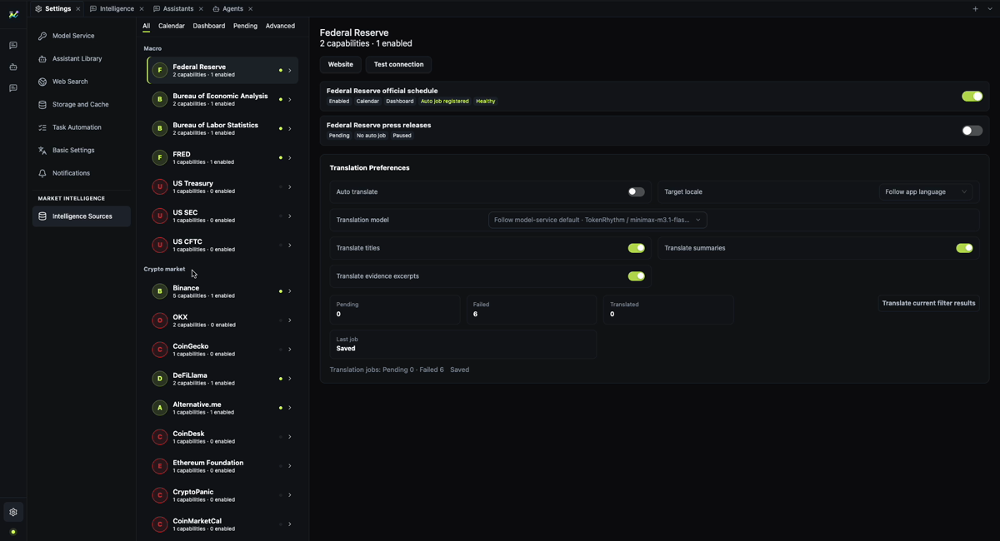

[English](./quick-start.md) | [中文](./quick-start.zh-CN.md)

# Quick start

This is the shortest path from a fresh checkout to a working market dashboard and analyst
conversation.

> MacroBay is a local desktop app. You provide the model provider and the data sources; the project
> does not bundle either.

## 1. Set up the model provider

Open **Settings → Model Service**.

1. Add a provider, or choose one from the catalog.
2. Enter the API key and enable the provider.
3. Add or enable a chat model.
4. Choose the **default model for agents**. If you use the assistant page, choose its default too.
5. Run **Connection check**.

The renderer only receives `hasApiKey` and a masked preview after saving. The raw key stays in the
main process and the platform secret store.

If the page reports `provider-not-ready`, check that the provider is enabled, the key is saved, and
the model is enabled.

## 2. Enable the intelligence sources

Open **Settings → Intelligence Sources**.

1. Enable the sources you have access to.
2. Add credentials for any source that requires them.
3. Keep the default collection presets unless you have a reason to change them.

The dashboard only renders panels backed by enabled sources. A missing or disabled source produces an
explicit gap; it is not silently filled with a neutral value.

The catalog mixes free and low-cost platform integrations. Enable what you need; some sources require
your own account, API key, or network access. If a panel stays empty while the source is enabled,
check the network and proxy settings before assuming the source is broken.

## 3. Open the dashboard

Open the **intelligence portal**, choose **Crypto Market Analyst**, and select **Open dashboard**.

The dashboard groups:

- macro context;
- cross-asset observations;
- capital conditions;
- the latest published analysis.

## 4. Ask the analyst

Open the analyst agent from the dashboard and ask a specific question, for example:

> What changed in the last macro release, and which assets does it affect?

A useful answer separates **facts**, **assumptions**, **conditions**, and **gaps**, and states the
cutoff time it used.

## What success looks like

- The dashboard shows values, not empty placeholders.
- Each reading can be opened to its evidence and source.
- The agent answer names the evidence and the cutoff time.
- A later revision does not silently rewrite an earlier answer.

## Next

- [Model service](./model-service.md)
- [Product overview](../product/overview.md)
- [Traceability](../product/traceability.md)
- [Status and limitations](../reference/status-and-limitations.md)
