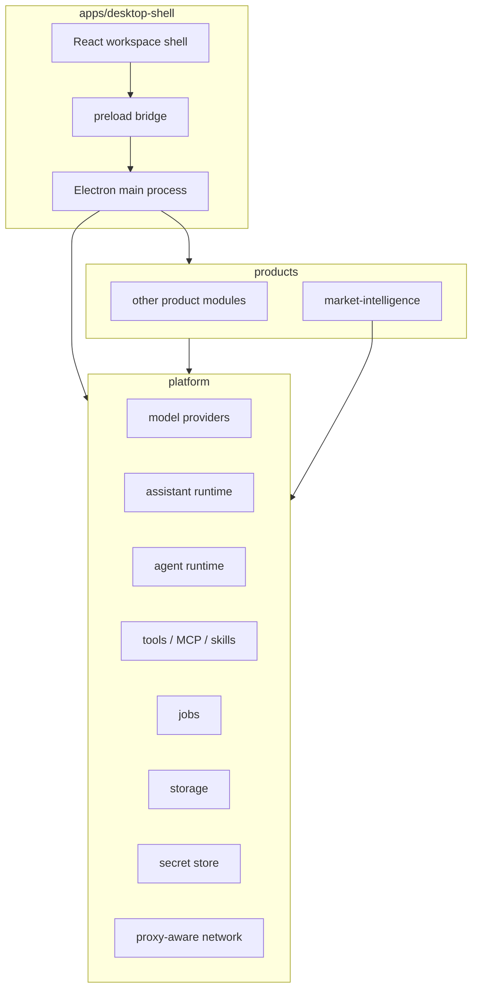

[English](./architecture.md) | [中文](./architecture.zh-CN.md)

# Architecture

MacroBay is a local-first Electron application built as a reusable platform plus removable product
modules. This page explains the parts a user or contributor needs to understand; it is not an
internal implementation manual.

## Three layers



### `apps/desktop-shell`

The desktop host. It owns the Electron main process, the preload bridge, the React workspace shell,
window lifecycle, and the generic settings/agent/assistant pages. It loads products through a
generated registry; it does not know product-specific data sources or business rules.

Window chrome is part of the shell and is platform-specific: on Windows the app draws its own title
bar (application icon, application menu, search/layout controls, window buttons), while macOS keeps
the native title bar with traffic lights. Both platforms share one application-menu definition, so
adding, removing, or implementing a menu item is a single change.

### `platform`

Generic capabilities that any product can use:

- model providers and protocol handling;
- assistant and agent runtimes;
- tools, MCP servers, and skills;
- jobs and scheduling;
- local storage and repositories;
- settings and secret storage;
- proxy-aware HTTP and WebSocket adapters.

`platform` must not import `products`. That rule is what keeps the shell usable when a product is
removed.

### `products/<product-id>`

A product owns its domain behavior: data-source adapters, schedules, prompts, pages, product tools,
and product agents. It declares what it contributes through a manifest. The bundled
`market-intelligence` product is the reference implementation.

## Product registration

The shell reads a generated registry rather than importing products directly:

```bash
pnpm generate:products
```

The generator scans product manifests and writes `products/generated/*`. Those files are build
artifacts and are not committed. `pnpm dev`, `pnpm test`, `pnpm typecheck`, and `pnpm build` run the
generator automatically.

A product can contribute:

- menu entries and settings panels;
- IPC contracts and service bootstraps;
- agent seeds and tools;
- workspace pages.

Removing a product removes its contributions. The generic shell must still start.

## Process boundary

```text
renderer  ── preload ──  main process  ──  local files / SQLite / outbound network
```

- The renderer does not receive raw provider credentials.
- Database access and outbound requests live in the main process or platform services.
- The preload layer exposes a typed, narrow API. New privileged capabilities require a platform
  contract, not an ad-hoc renderer fetch.

## Local-first data

The app keeps its state under the Electron `userData` directory:

```text
MacroBay/
  platform/        settings, model providers, agent/assistant databases
  logs/            local logs
  ...              product-owned data
```

Provider credentials are stored through the platform secret store backed by Electron
`safeStorage`. The renderer sees only masked previews and readiness flags.

## Time and evidence

Market-intelligence queries carry an explicit `asOf` boundary. Historical reads must not mix in
records created after that boundary. The same evidence records feed the dashboard, the analyst
agent, and the provenance view, so a number shown in a panel can be traced back to the record that
produced it.

## Current limitations

- Channel integrations are present in the platform code but hidden in this release.
- Packaged installers and auto-update are not included.
- macOS is the verified development platform; Windows and Linux are experimental.

See [Status and limitations](../reference/status-and-limitations.md).

## Next

- [Platform and products](./platform-and-products.md)
- [Privacy and security](./privacy-and-security.md)
- [Development setup](../development/setup.md)
