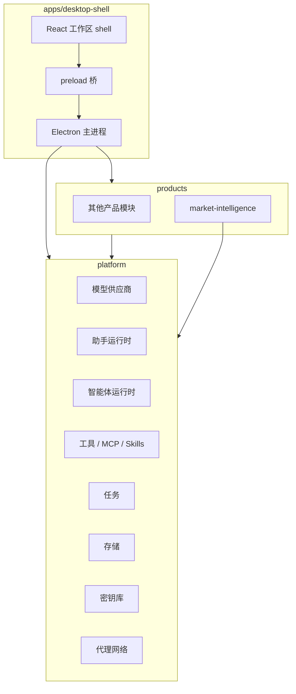

[English](./architecture.md) | [中文](./architecture.zh-CN.md)

# 架构

MacroBay 是一个本地优先的 Electron 应用，由可复用的平台和可拆卸的产品模块组成。本文面向使用者
和贡献者，解释需要理解的边界，不是内部实现手册。

## 三层结构



### `apps/desktop-shell`

桌面宿主。负责 Electron 主进程、preload 桥、React 工作区 shell、窗口生命周期，以及通用的设置、
智能体、助手页面。它通过生成的产品注册表加载产品，不知道产品专属的数据源和业务规则。

### `platform`

任何产品都可以使用的通用能力：

- 模型供应商与协议处理；
- 助手和智能体运行时；
- 工具、MCP server 和 Skills；
- 任务与调度；
- 本地存储与 repository；
- 设置和密钥存储；
- 支持代理的 HTTP / WebSocket 适配器。

`platform` 不得 import `products`。这条规则保证删除一个产品后 shell 仍然可用。

### `products/<product-id>`

产品拥有自己的领域行为：数据源 adapter、调度、提示词、页面、产品工具和产品智能体。它通过
manifest 声明自己贡献什么。内置的 `market-intelligence` 是参考实现。

## 产品注册

shell 读取生成的产品注册表，而不是直接 import 产品：

```bash
pnpm generate:products
```

生成器扫描产品 manifest，写出 `products/generated/*`。这些是构建产物，不提交。`pnpm dev`、
`pnpm test`、`pnpm typecheck`、`pnpm build` 都会自动执行生成器。

一个产品可以贡献：

- 菜单项和设置面板；
- IPC 契约和 service bootstrap；
- 智能体 seed 和工具；
- 工作区页面。

删除产品就删除它的贡献。通用 shell 必须仍然能启动。

## 进程边界

```text
渲染层  ── preload ──  主进程  ──  本地文件 / SQLite / 出站网络
```

- 渲染层拿不到原始供应商凭据。
- 数据库访问和出站请求在主进程或平台服务中完成。
- preload 只暴露窄而明确的类型化 API。新增特权能力应先有平台契约，而不是在渲染层直接 fetch。

## 本地优先数据

应用状态保存在 Electron 的 `userData` 目录：

```text
MacroBay/
  platform/        设置、模型供应商、智能体/助手数据库
  logs/            本地日志
  ...              产品自己的数据
```

供应商凭据保存在平台密钥库中，底层是 Electron `safeStorage`。渲染层只看到掩码预览和就绪状态。

## 时间与证据

市场情报查询带明确的 `asOf` 边界。历史读取不得混入该边界之后创建的记录。看板、分析智能体和
来源追溯使用同一批证据记录，因此面板上的数字可以追回到产生它的记录。

## 当前限制

- 渠道集成代码仍在平台里，但本版本没有开放。
- 不包含打包安装程序和自动更新。
- macOS 是已验证的开发平台；Windows、Linux 仍是实验性支持。

参见[状态与限制](../reference/status-and-limitations.zh-CN.md)。

## 下一步

- [平台与产品](./platform-and-products.zh-CN.md)
- [隐私与安全](./privacy-and-security.zh-CN.md)
- [开发环境](../development/setup.zh-CN.md)
