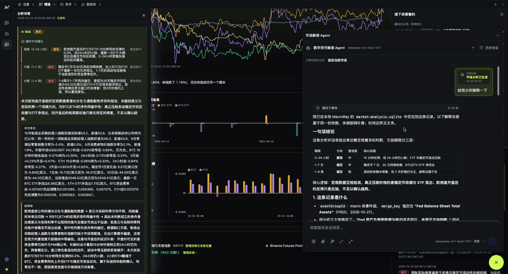

[English](./analysis-workflow.md) | [中文](./analysis-workflow.zh-CN.md)

# 分析流程

市场情报流程的目标，是让问题、证据和解读保持在一起。

## 1. 选择市场或标的

从情报门户或看板进入，选择要查看的市场上下文。这个选择决定分析可以使用哪些证据。也可以不选择
直接提问，但答案必须说明上下文缺失。

## 2. 绑定上下文

选中看板节点或日历事件后，对话会携带对它的引用。引用告诉智能体问题针对哪个事件或分析节点；
智能体不应静默猜成另一个。

如果选中的上下文读取失败，产品会报告缺口，而不是用通用总结替代。

## 3. 提问

问题应具体到可以用证据检验：

- 最近一个观测窗口里发生了什么变化？
- 这个读数来自哪个来源？
- 什么情况会推翻当前解读？
- 这个事件如何影响选中的市场？

当某个选择会改变分析时，智能体可以反问一个结构化问题，例如时间窗口或对比基准。

## 4. 阅读分析

完整的分析会把以下内容分开：

- **事实**：观测值及其来源；
- **假设**：解读默认成立的前提；
- **条件**：什么情况下情景会改变；
- **缺口**：现有证据回答不了什么。

同时给出观测时间和 `asOf` 边界。缺少这些要素的分析是不完整的。

## 5. 审批与停止

读取本地文件、执行命令或改变状态的工具可能需要审批。审批行会显示工具和它将做什么。结构化提问
使用选择卡片，而不是 JSON 编辑器。

可以停止正在运行的一轮。执行记录会保留已完成的步骤，并把这一轮标为已停止，而不是假装成功。

## 输出不是什么

- 不是交易指令。
- 不保证某个情景一定发生。
- 不能替代对底层来源记录的核对。

## 下一步

- [可追溯性](./traceability.zh-CN.md)
- [分析智能体](./analyst-agent.zh-CN.md)
