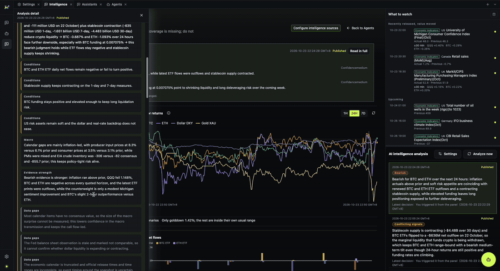

[English](./analyst-agent.md) | [中文](./analyst-agent.zh-CN.md)

# Analyst agent

The market analyst is a product-owned agent built on the platform's Claude Code runtime. It reads
market evidence and publishes conditional analysis.



## What makes it different from ordinary chat

An ordinary assistant answers from the conversation. The analyst agent can:

- read registered market evidence through product tools;
- bind a dashboard node or calendar event as context;
- ask a structured question when a choice changes the analysis;
- show a tool-approval card before an action that needs confirmation;
- keep an execution trace with tool calls, elapsed time, retries, and a final answer.

The platform still owns the runtime; the product owns the prompt, tools, and analysis rules.

## Tool approvals

A tool that reads local files, runs a command, or changes state may require approval. The approval
row shows the tool name and what it will do. Approving allows the call; denying stops it with a
reason.

If an approval card is already resolved or expired, submitting it shows an explicit error instead
of silently doing nothing.

## Structured questions

When the agent needs a choice, it uses an `AskUserQuestion` card:

- one question at a time;
- numbered options with descriptions;
- a recommended option when the agent has one;
- a freeform answer field;
- previous/next for multiple questions;
- skip or submit.

The answer is returned to the runtime as structured data, not as a chat message that the model has
to parse.

## Execution trace

The execution trace is folded by default when a turn completes:

```text
Completed in 1m 47s
  └─ Executed commands
       └─ tool row
            └─ output
```

While the turn is running, new rows appear as the runtime produces them. A failed turn shows the
error row and the error code when one is available.

## Model choice

The agent runtime expects a Claude Code-compatible Messages route. The composer model menu lists
models that satisfy the runtime constraints. A model that is rate-limited or temporarily unreachable
stays selectable and is marked unverified instead of disappearing.

## Analysis rules

The analyst agent is instructed to:

- separate facts, assumptions, conditions, and gaps;
- state the observation time and `asOf` boundary;
- prefer conditional scenarios over unconditional advice;
- refuse to invent a source when evidence is missing.

These are product rules, not a guarantee that every model follows them perfectly. Check the
evidence and the trace.

## Next

- [Analysis workflow](./analysis-workflow.md)
- [Traceability](./traceability.md)
- [Model service](../getting-started/model-service.md)
