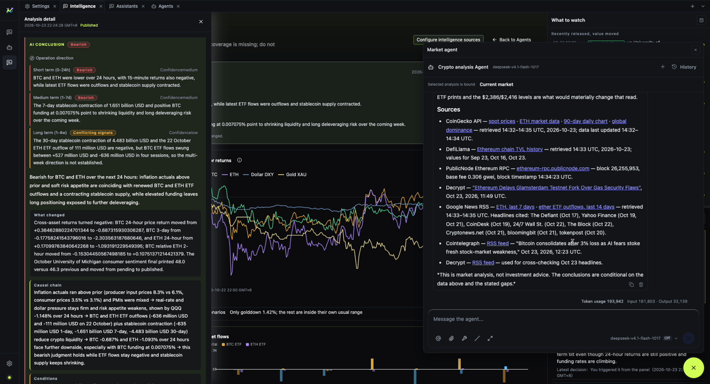

[English](./analyst-agent.md) | [中文](./analyst-agent.zh-CN.md)

# 分析智能体

市场分析智能体是产品自带的智能体，运行在平台的 Claude Code 运行时上。它读取市场证据，输出
条件化分析。



左边是看板，右边是智能体，两者读的是同一批证据记录。下面的录屏是同一个视图的动态版本：


## 和普通聊天有什么不同

普通助手只根据对话回答。分析智能体可以：

- 通过产品工具读取已注册的市场证据；
- 把看板节点或日历事件绑定为上下文；
- 在某个选择会改变分析时提出结构化问题；
- 在执行需要确认的动作前显示工具审批卡片；
- 保留包含工具调用、耗时、重试和最终答案的执行记录。

平台仍然拥有运行时；产品拥有提示词、工具和分析规则。

## 工具审批

读取本地文件、执行命令或改变状态的工具可能需要审批。审批行会显示工具名和它将做什么。允许会放行；
拒绝会带原因终止。

如果审批卡片已经处理过或过期，提交时会明确报错，而不是静默无反应。

## 结构化提问

智能体需要选择时，会使用 `AskUserQuestion` 卡片：

- 一次一个问题；
- 带序号的选项和说明；
- 有推荐项时显示推荐；
- 自由输入框；
- 多问题时可以上一题/下一题；
- 跳过或提交。

答案以结构化数据返回运行时，而不是让模型再解析一条聊天消息。

## 执行记录

一轮结束后，执行记录默认折叠：

```text
已完成，用时 1 分 47 秒
  └─ 执行了命令
       └─ 工具行
            └─ 输出
```

运行过程中，新记录会随着运行时产生逐条出现。失败的一轮会显示错误行；有错误码时一并显示。

## 模型选择

智能体运行时要求 Claude Code 兼容的 Messages 路由。输入框的模型菜单只列出满足运行时约束的模型。
被限流或暂时不可达的模型仍然可选，并标记为“未验证”，而不是消失。

## 分析规则

分析智能体被要求：

- 区分事实、假设、条件和缺口；
- 说明观测时间和 `asOf` 边界；
- 优先给条件化情景，而不是无条件建议；
- 证据缺失时拒绝编造来源。

这些是产品规则，不保证每个模型都完美遵守。请核对证据和执行记录。

## 下一步

- [分析流程](./analysis-workflow.zh-CN.md)
- [可追溯性](./traceability.zh-CN.md)
- [模型服务](../getting-started/model-service.zh-CN.md)
