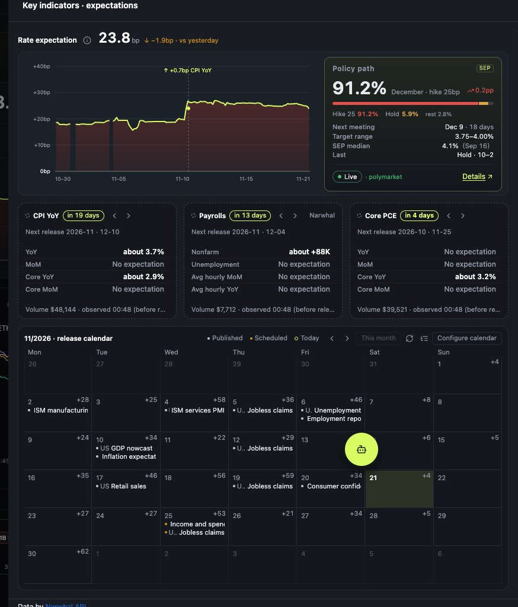
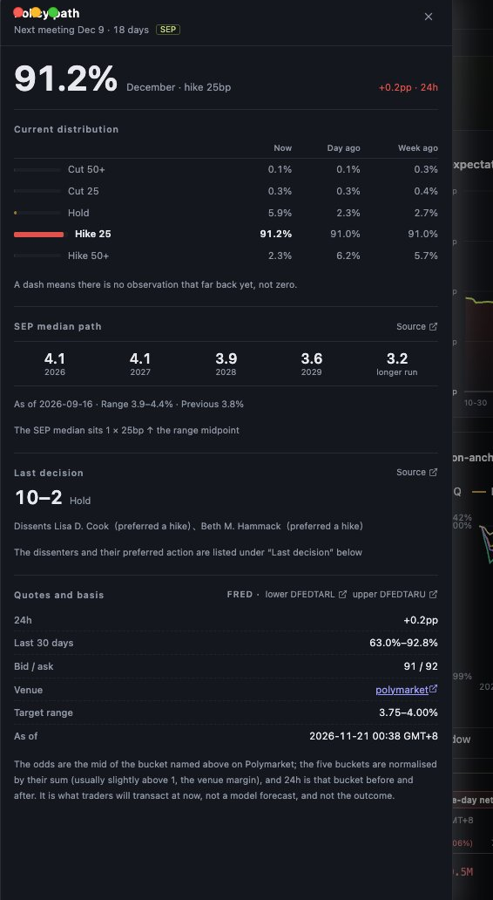
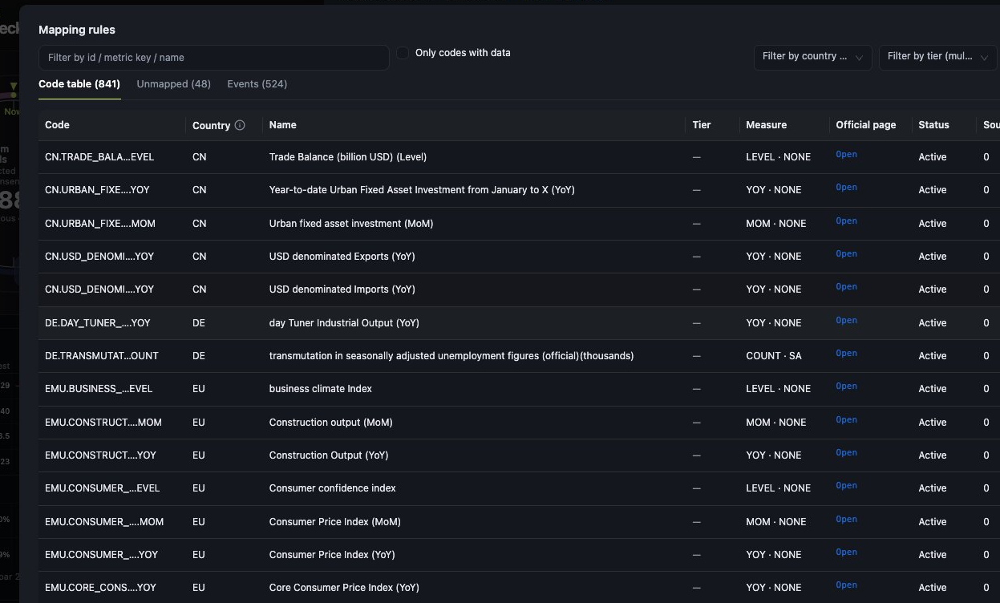

[English](./calendar.md) | [中文](./calendar.zh-CN.md) | [← Docs](../README.md)

# Macro calendar: key indicators and release schedule

The calendar is not a page. The calendar icon at the top right of the dashboard opens a drawer titled
**Key indicators · expectations**: the upper half tells you which prints will reprice the next few
weeks, the lower half is the release calendar for the current month, and the right column holds what to
watch next and the events of the day. Close it and you are back on the page you came from; the dashboard
keeps its state.

## Upper half: policy path and three core indicators

- **Policy path**: the implied odds of a rate move at the next meeting, with the meeting date, the
  current policy range, the SEP median and the result of the previous meeting. The card names its data
  source (polymarket); the bottom right opens the detail.
- **Three core indicator cards**: CPI YoY, payrolls, core PCE YoY. This is the "core indicators" layer the
  calendar sets aside on purpose — it does not spread hundreds of series across the page, it picks the
  three the market prices directly and puts them next to the policy path. Each card carries the next
  release date, how many days away it is, and the expected YoY / MoM / core YoY / core MoM values; the
  foot of the card shows when those expectations were observed and their volume.
- The countdown is a plain difference in calendar days to the release date, not a vague "due this week".

**Details** opens the policy path's own panel: the current distribution across five buckets (cut 50+ down
to hike 50+), each with its share now, a day ago and a week ago; the SEP median path, year by year out to
the long run; how the previous meeting split its vote; and the quote and basis — bid/ask, venue, target
range and the as-of time, with a note at the bottom on where these odds come from and why the five buckets
are normalised by their own sum, which usually runs slightly above 1.

## Lower half: the release calendar for the month

- Each day cell carries the number of events that day and their names; published, scheduled and today
  are marked differently, and today is highlighted.
- The top offers **back to this month** and a way into **configure the calendar**; the arrows beside it
  change the month.
- Events carry their country (the U.S., Japan, Canada and others). Pick a day and the right column
  switches to that day's events.

## Right column: what to watch, and the day's events

- **What to watch** has two parts: **scheduled**, and **recently released with a change**. Released items
  show prior and actual values; an item whose release time has passed without a value says it is
  waiting for the actual value instead of inventing a number.
- **The day's events** start with counts and are then grouped: what is in the **standard table**, what is
  **not in it**, **tier-two indicators**, **high-importance events**, and **the rest**. The groups
  collapse; the counts stay visible.

## Reading one event's state

The state is one of a fixed set, never free text: **data received**, **scheduled**, **awaiting data**,
**not provided**, **time pending**, **past its scheduled time**, **cancelled**, **storage limited**.

The event detail shows the category, period, source, release time, importance, actual and prior values,
and the **expectation** in one of four states — a value; the source gives none ("not provided by the
source"); an observation exists but the expectation field is empty (reported as a data gap, with the
reason); or the market observation could not be read this time (reported as unreadable, with the reason
that the read failed and the expectation is not absent). **"Nothing there" and "cannot be read" stay two
different states**, never merged into one empty dash.

- **Revisions are stored separately**: when an official number is later restated, the earlier reading does
  not disappear; the detail keeps a revision record of who changed it and when.
- **The website link is drawn from data**: an event gets one only when it has a matching indicator code;
  otherwise it says "to be checked" rather than pointing at a guessed address.

## Mapping rules: 841 codes, 524 events

Which indicators can appear at all, and which code each one maps to, come from a mapping table that is
readable from the calendar itself:

- Three tabs: **Code table (841)**, **Unmapped (48)**, **Events (524)**.
- Filter by id, code or name, or tick "only codes with data"; then filter by country, tier or official page.
- Every row gives the code, country, name, tier, measure (for example YOY · NONE, MOM · NONE), the official
  page (an **Open** link when there is one), status, the number of source ids and the data volume.
- The table exports to Excel, so checking how many legs a single indicator is fed by does not require
  asking us.

## Where the data comes from, and how large it is

- **841 economic indicator codes** (195 of them U.S.) and **524 collected release events** are built in,
  covering the official schedules of the U.S. Bureau of Labor Statistics, BEA and the Fed, plus Japan,
  Canada and other markets, together with market-side consensus.
- **The 48 items not yet mapped into the standard table are listed separately** rather than mixed into it
  as if they were aligned — that is what "not in the standard table" in the right column is for.
- Official schedules and the market calendar are two legs: the official side gives dates and prior
  values, the market side gives expectations; when they disagree each names its own source instead of one
  silently winning.
- The drawer's footer names where the schedule and consensus values come from.

## Limits

- **The official calendar from the U.S. Bureau of Labor Statistics is unreachable** (the endpoint returns
  403), so automatic sync stays off. What is already stored is frozen at the last successful sync and
  those events carry no release time — no time is invented. See
  [Status and limitations](../reference/status-and-limitations.md).
- **An event with no confirmed time is not given a fake one**: it says the time is pending rather than
  showing a plausible-looking clock time.
- The calendar is decision context, not a trading signal: it tells you when data arrives, not what to buy
  or sell.
