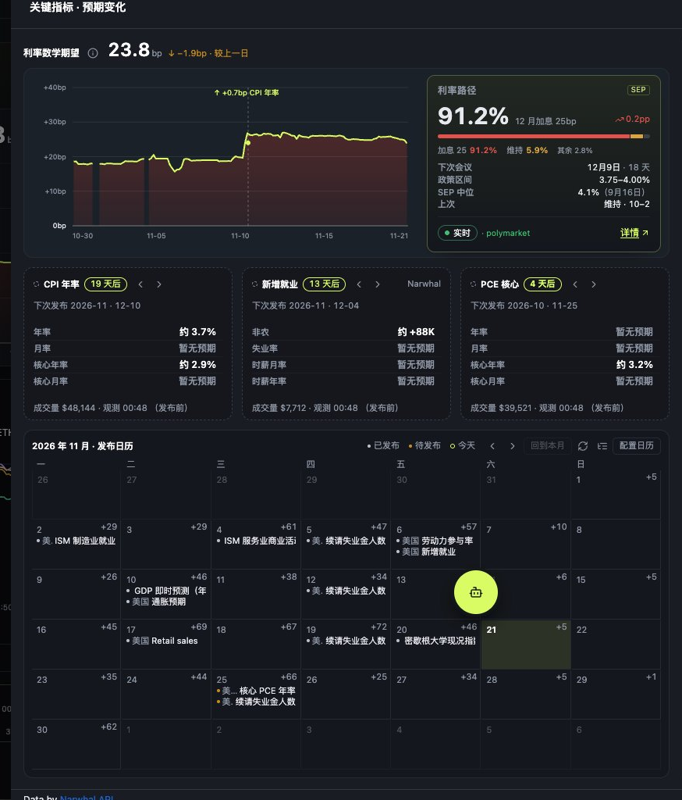
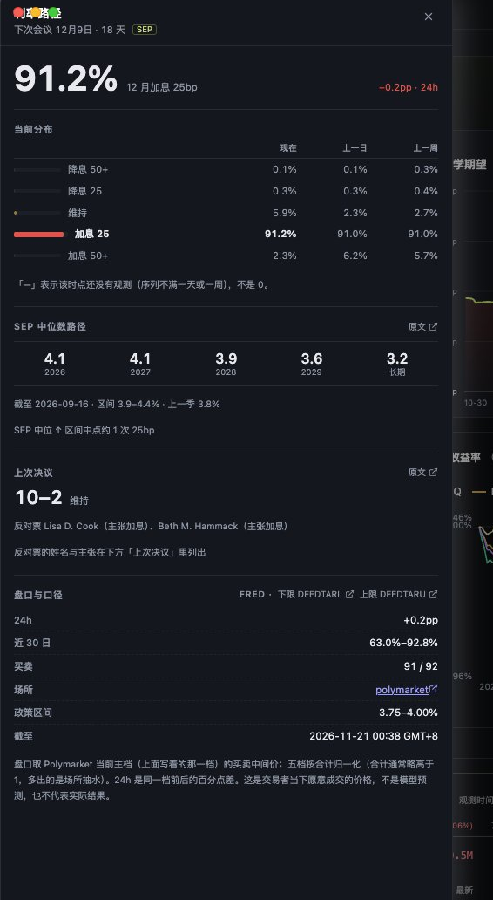
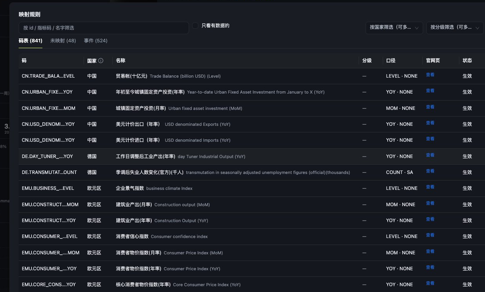

[English](./calendar.md) | [中文](./calendar.zh-CN.md) | [← 文档首页](../README.zh-CN.md)

# 宏观日历：关键指标与发布日程

日历不是一整页。看板页右上角的日历图标打开的是一个抽屉，标题是**关键指标 · 预期变化**：上半告诉你
接下来几周会被哪些数据定价，下半是当月的发布日程，右栏是「接下来要看的」和当天的事件。关掉它，
你回到刚才那一页，看板状态不动。

## 上半：利率路径与三个核心指标

- **利率路径**：下一次会议隐含的加息／降息概率，加上会议日期、当前政策区间、SEP 中位与上一次会议的
  结果。卡上标着数据来源（polymarket），右下角进详情。
- **三张核心指标卡**：CPI 年率、新增就业、核心 PCE 年率。这就是日历里单独划出来的「核心经济指标」那一层——
  它不平铺几百个指标，只挑三个会被市场直接拿来定价的，和利率路径并排放。每张卡写清下次发布的日期、
  还有几天、以及年率／月率／核心年率／核心月率的预期值；卡底是这批预期值的观测时间和成交量。
- 倒计时用的是发布日的自然日差，不是「预计在本周」这类含糊说法。

点「详情」进的是利率路径自己的面板：当前分布的五个档位（降息 50+ 到加息 50+）各自在现在、上一天、上一周
的占比，SEP 中位数路径逐年给到长期，上一次会议的投票分成，以及盘口与口径——买卖价、场所、政策区间与
截至时间，底部写明这批概率从哪来、五项为什么按自身之和归一（这个和通常略高于 1）。

## 下半：当月发布日历

- 每天格子里是当天的事件条数与事件名；已发布、待发布与今天用不同标记区分，今天那一格高亮。
- 顶部可以**回到本月**，也可以直接进**配置日历**；两侧箭头翻月。
- 事件按国家标出（美国、日本、加拿大等），点开某一天，右栏换成那一天的事件。

## 右栏：接下来要看的，与当天事件

- **接下来要看的**分成两段：**待发布**，和**最近已公布（有变化）**。已公布的条目给前值与实际值；
  到了发布时刻还没有数值的，写「已到发布时间，等待实际值」，不会编一个数出来。
- **当天事件**先给计数，再分组列出：**标准表**里的、**未入标准表**的、**二级指标**、**高重要性事件**、
  **其余**。分组可以折叠，计数始终显示。

## 一条事件的状态怎么读

事件状态是固定几档，不写自由文本：**数据已获取**、**待发布**、**待补值**、**未提供**、**时间待定**、
**计划时间已过**、**已取消**、**存储受限**。

打开事件详情能看到：类别、统计周期、来源、发布时间、重要性、实际值与前值，以及**预期值**四种情况——
有值；源没给（写「源未给出」）；已有观测但预期字段为空（写「数据缺口」并说明）；这次没读到市场观测
（写「暂时读不到」，并说明是读取失败，不是没有预期）。**「没有」与「拿不到」是两种状态**，不会合并成
一个空的破折号。

- **数值修订另存**：官方后来改了数，旧的读数不会因此消失，详情里有一块「数值修订」记录谁在什么时候
  改过。
- **官网链接**按数据画：这条事件有对应指标码才给官网；没有就写「待核」，不拿一个猜的地址顶上。

## 映射规则：841 个指标码、524 场事件

日历里能出现哪些指标、每个指标归到哪个码，来自一张映射表；它在日历里直接可查：

- 三个页签：**码表（841）**、**未映射（48）**、**事件（524）**。
- 可以按 id／指标码／名字筛，也可以只看有数据的；再按国家、按分级、按官网页筛。
- 每一行给：码、国家、名称（按界面语言取一个，另一种在悬停里）、分级、口径（如 YOY · NONE、MOM · NONE）、官网页（有就标「查看」）、
  状态（生效）、源 id 数、数据量。
- 表可以导出 Excel，想自己核「这个指标到底接了几条腿」不用找我们。

## 数据从哪来，规模多大

- 内置 **841 个码表代码**（其中美国 284 个：283 个指标、1 个事件）与 **524 场已采集的日程事件**，覆盖美国劳工统计局、
  BEA、美联储的官方发布日程，加上日本、加拿大等市场的日历，以及市场侧的一致预期。
- **未映射进标准表的 48 条单独列出**，不混进标准表假装已经对齐——右栏的「未入标准表」就是给它们的位置。
- 官方发布日程与市场日历是两条腿：官方给日期与前值，市场侧给预期；两边对不上时各自标明来源，不静默
  选一个。
- 抽屉页脚标出这批日程与共识值的来源。

## 限制

- **美国劳工统计局的官方日历取不到**（对方返回 403），自动同步保持停用；库里已有的那批数据停在上一次
  成功同步，这些事件没有发布时间——不显示一个编出来的时刻。详见[状态与限制](../reference/status-and-limitations.zh-CN.md)。
- **时间待定的事件不给假时间**：宁可写「时间待定」，也不排一个看起来正常的时刻。
- 日历是决策环境，不是交易信号；它告诉你什么时候会有数据，不告诉你该买还是该卖。
