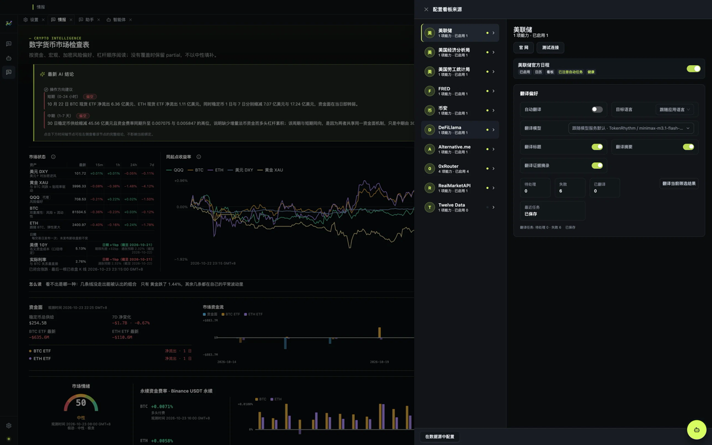

[English](./crypto-market-analyst.md) | [中文](./crypto-market-analyst.zh-CN.md)

# 数字货币市场解读员

数字货币市场解读员是市场情报模块里第一个可用的 Agent。它读你配置好的加密证据——资金费率与持仓、
现货与跨资产、风险偏好、稳定币供给、交易所与监管事件、宏观发布——并把条件式分析发布在产生它的
看板旁边。

每一句判断都绑定到证据记录和一个 `asOf` 边界。证据缺失时，答案会直接说明缺口，而不是用一个中性
值把缺口填上。

同一个门户里还有两个同类 Agent——股票市场解读员和期货市场解读员——目前都标记为**准备中**，还不能
配置。

还没有 Key 也可以先看一眼：门户上的**示例模式**会用真实录制的一周回放完整看板与三条已发布结论，
不联网、不写你的数据，关掉即回到你自己的（空）数据。要自己做分析，再从下面第 1 步开始配置。

## 现在有什么，后面会开什么

加密情报是当前的主线，而且会继续加深：更多交易所与衍生品覆盖、ETF 与资金流历史、链上信号、事件
驱动的告警。最近的文本事件也会在看板的[舆情](./news-sentiment.zh-CN.md)卡片里给出方向判断。

门户里已经能看到接下来的两栏——股票市场解读员和期货市场解读员——但它们标记为**准备中**：没有来源、
没有看板，也没有可配置项。每个栏目开放时都会沿用这一栏的形状：自己的证据集、自己的看板，以及同样的
规则——每个数字都带着来源和截止时间。加密这一栏不依赖它们，你今天配好的环境也不会被它们绑住。

## 分析从哪里来

解读员的判断不是一段通用提示词套在行情接口上。它来自一位长期交易加密的复盘笔记：穿越多轮周期之后，
什么真的推动了价格，什么看起来像信号其实不是，哪些错误反复出现。这些笔记后来变成了提示词、检查清单，
以及它在给出判断之前必须先说清楚的条件。

经验在这里是起点，不是权威。解读员仍然要交代证据；笔记也还在生长——经得起复盘的新的心得会被写回
产品，所以分析应该越来越具体，而不是越来越自信。

我们不声称任何战绩，这也不是投资建议。想说明的事情更窄：这套推理来自真正做过这件事的人，并且它
始终保留被证伪的余地。

## 七个预置分组

门户卡片上写的是「7 个静态情报源」。这七个是**预置分组**，不是七个单独的数据源：每个分组打包了
支撑画面某一块的来源。

| 预置分组 | 等级 | 背后的来源 | 它支撑什么 |
| --- | --- | --- | --- |
| 恐惧与贪婪 | 必需 | 市场情绪指数（公开接口） | 市场情绪仪表 |
| 现货与动量 | 必需 | 交易所行情、市场报价、美元指数 | 市场状态、跨资产对比 |
| 资金费率 | 必需 | 交易所永续合约的费率与持仓 | 永续资金费率与持仓 |
| 宏观日历 | 推荐 | 美联储、BEA、BLS 的官方日程，加上市场日历 | 宏观发布动态、经济日历 |
| 稳定币与 DeFi | 推荐 | 稳定币供给与 DeFi TVL 数据 | 资金面 |
| 监管与交易所 | 推荐 | SEC、CFTC 公告，交易所公告与状态页 | 时间线与解读证据 |
| 行业新闻 | 可选 | 行业媒体、项目官方博客、代码仓库发布 | 背景信息 |

「激活」只会打开三个**必需**分组。推荐和可选分组由你自己决定；没开的来源会以缺口的形式出现，而不是
变成一个假装完整的空面板。

## 开始之前

- **模型供应商。** 解读员跑在平台的 Claude Code 运行时上，需要一个已启用、且提供 Agent 兼容模型的
  供应商。见[模型服务](../getting-started/model-service.zh-CN.md)。
- **可选凭据。** 少数接口需要 API Key（BEA 用免费的 User ID），多数来源不需要。没有它们，情报台
  仍然能跑，只是面板少一些。
- **本地代理（部分来源必需）。** 个别数据接口会拦截来自大陆网络的请求，必须走代理才能采集。
- **macOS。** 这是已验证的平台；Windows 和 Linux 预期可以运行，但尚未验证。

## ⚠️ 本地代理（部分来源必需）

  

部分数据源必须走本地代理才能采集。

部分数据接口——ETF 流向、市场报价，以及它们承载的那部分市场日历——会拦截来自大陆网络的请求。
没有代理时，「测试连接」和「刷新市场日历」会一直失败——这跟 API Key 是否正确没有关系，先别怀疑
Key。

浏览器能打开也不等于应用能连：应用的请求只走「设置 → 基础设置」里的代理配置。

### 怎么设置本地代理

1. **先让代理软件跑起来。** 打开你常用的本地代理或 VPN 客户端，确认它在本机监听一个端口。常见形态是
   `http://127.0.0.1:7890` 或 `socks5://127.0.0.1:6153`，端口以客户端里显示的为准。
2. **进入设置。** 打开 **设置 → 基础设置 → 代理模式**。
3. **改成自定义代理。** 默认的「系统代理」不一定被应用读到，选「自定义代理」最稳。
4. **填地址。** 把第 1 步的地址原样填进**代理地址**，例如 `http://127.0.0.1:7890`。HTTP 代理用
   `http://`，SOCKS5 用 `socks5://`，不要混用。
5. **保留绕过规则。** **代理绕过规则** 保持 `localhost,127.0.0.1,::1`，让本机流量直连。
6. **点「测试代理」。** 自检通过会显示类似 `代理自检：通过（HTTP 200，0.8s，经 http://127.0.0.1:7890）`；
   失败会给出错误码和目标地址。
7. **回到来源里重试。** 打开 **设置 → 情报源**，选中带「需要代理」徽章的来源，点**测试连接**，成功后
   再点**立即运行**；也可以在看板的**配置看板来源**抽屉里逐个运行。

设置保存后立即生效，不需要重启应用。

### 常见失败

| 现象 | 原因 | 处理 |
| --- | --- | --- |
| 测试代理失败 | 代理没开、端口填错，或协议写错 | 对照客户端里的监听地址重填 |
| 代理自检通过，来源仍失败 | 代理按域名分流，放行了浏览器但没放行应用 | 把目标域名加进代理规则，或临时切全局模式 |
| 浏览器能开，应用不能 | 应用只走平台代理设置 | 改用自定义代理，并确认地址与客户端一致 |
| 提示认证失败 | 代理需要账号密码 | 换一个免认证的本地端口，或使用支持认证的地址格式 |
| 换网络后全部失败 | 公司网络或热点拦截 | 切回可访问的网络，或改用系统代理 |

## 1. 配置模型

**设置 → 模型服务**：添加供应商、保存 API Key、启用，并为 Agent 选择默认模型。在依赖它之前，先点
连接检查确认 Key 可用。

看板里的分析面板还有自己的 **AI 分析设置**：默认跟随默认助手模型，也可以指定分析模型。关闭 AI 分析
不会删除历史分析，只是不再生成新的。

如果 Agent 显示「未选择模型」，原因通常是没有任何已启用的供应商，或已启用的供应商都没有运行时能用的
模型。

## 2. 激活解读员

在侧边栏打开**情报**。数字货币市场解读员的卡片会显示预置摘要，以及两种状态之一：「配置激活」，或者
（对另外两个同类 Agent）「准备中」。

点**配置并激活**。抽屉会按等级列出七个预置分组和背后的来源，并说明每组需要什么。

点**激活**。这会把三个必需分组里「已实现且尚未启用」的来源全部打开。它不会替你填凭据，也不会立刻
采集数据——那是下两步的事。

然后点**打开看板**。

## 3. 需要凭据时再填

进入**设置 → 情报源**。左侧是来源树，可按 全部 / 日历 / 看板 / 待接入 / 高级 过滤；选中一个供应商，
右侧打开详情。

需要凭据的接口只有少数几类，都需要 API Key（BEA 例外，用免费的 User ID）；其余来源不需要凭据。

这个页面有两件事要留意：

- **实现状态。** 标「可采集」的来源现在就能跑；「Fixture 可验证」只支持 fixture 重放；「待实现」
  的来源不能启用，界面会直接说明，而不是默默接受开关。
- **凭据处理。** Key 写入平台密钥存储，设置页只显示掩码预览。填完后点**保存并验证连接**，先看结果
  再相信面板。

## 4. 选择采集策略

每个供应商都有采集策略：

- **采集预设**——手动、均衡或高频。手动意味着「启用」并不会自动拉数据，需要你自己点立即运行。
- **纳入情绪分析**——这个来源是否参与情绪信号的计算。
- **范围策略**——全部、自选优先或持仓优先，只对可以收窄范围的来源生效。
- **保留与重放**——是否归档原始数据，以及解析器升级后是否自动重放。
- **来源健康**——最近成功、最近失败、连续失败次数和最近运行摘要。

页面顶部的操作是**立即运行**、**刷新健康状态**和**重放窗口**。

## 5. 先采集一次

启用来源之后，先确认它有没有数据：

- **等待首次采集**：定时还没触发，点**立即运行**。
- **未配置**：来源已开，但缺必需的 Key。
- **已配置未启用**：配置好了，但开关是关的。
- **采集失败**：会给出错误码，展开该供应商的来源健康看最近运行摘要。
- **数据过期，已回退**：本应更新的值没到，面板显示上一次有效读数和它的时间。

看板上还有一条来源状态条，以及**配置看板来源**抽屉：它把每个面板和供给它的供应商对上。

## 6. 看懂看板

| 面板 | 显示什么 | 依赖什么 |
| --- | --- | --- |
| 市场状态 | DXY、黄金、QQQ、BTC、ETH、美债 10 年期，以及 15m/1h/24h/7d 变化 | 美元指数、市场报价、交易所行情、美联储利率 |
| 跨资产同锚收益 | DXY、黄金、QQQ、BTC、ETH 归一化到同一把尺 | 同一批行情数据 |
| 资金面 | 稳定币总供给、7 天净变化、BTC/ETH ETF 最新读数、市场资金流 | 稳定币数据、ETF 流向数据 |
| 市场情绪 | 恐惧与贪婪仪表，带区间和观测时间 | 情绪指数接口 |
| 永续资金费率 | BTC、ETH 资金费率、谁付给谁，以及历史 | 交易所永续合约数据 |
| 宏观发布动态 | 按官方日期分组的未发布与已发布事件，带前值和实际值 | BLS、BEA、美联储、市场日历 |
| 最新 AI 结论 | 各周期的方向、置信度和结论块 | 解读员 |
| 关注清单与时间轴 | 最近发布和即将发布的事件、已发布分析及其状态 | 日历、分析运行 |

两种回退会被标注出来，而不是藏起来：真实美元指数不可用时，美元那一行可能显示本产品计算的合成
值；精确的纳斯达克 100 指数不可用时，QQQ 可能通过明确标注的替代序列显示。美联储的日频利率会带上
交易日，且可能滞后数个交易日——它解释的是环境，不是盘中波动。

方向是按周期分别给出的——短期（0-24 小时）、中期（1-7 天）、长期（1-4 周）——并配低/中/高置信度。
某个周期没有方向，意味着证据不支持判断，而不是"中性"。

## 7. 向解读员提问

看板和对话共享一个工作区：用**分析对话**和**市场看板**标签切换，**完整 Agent 面板**会打开独立会话。

- 选中看板节点或某个日历事件，就会把它绑定为上下文。Agent 回答的是那个节点，而不是凭空猜一个。
- 问能被证据检验的问题：*最近一次宏观发布变化了什么*、*这个读数来自哪个来源*、*什么情况下这个判断
  会失效*。
- 当某个选择会改变答案时（比较窗口、基准），Agent 会用结构化问题卡片来问，你的回答以数据形式回到
  运行时。
- 可能读本地文件、执行命令或改变状态的工具，会先请求批准。
- 运行中可以停止；轨迹会保留已完成的步骤，并把这一轮标记为已停止。

## 怎么核对一个回答

一份完整的分析会把五件事分开写：带来源引用的**事实**、**假设**、让解读成立的**条件**、**缺口**，
以及**时间边界**——观测时间加上 `asOf` 截止点。

已发布的分析还会带结论块——本次变化、因果链、成立条件、宏观侧、证据强弱、数据缺口——以及验证状态，
它会从待验证走到已确认、部分确认、已失效或已到期。

核对单个数字的方法就是点开它：证据视图会显示来源记录、观测时间，以及这次查询使用的截止点。后来的
修订不会被回填进更早的答案。

## 排查

| 现象 | 可能原因 | 处理 |
| --- | --- | --- |
| 面板空白或显示「未配置」 | 来源没开，或缺 Key | **设置 → 情报源**：启用、保存 Key，再运行一次 |
| 一直停在「等待首次采集」 | 手动预设 | 点**立即运行** |
| 来源健康显示失败 | 网络、代理、Key 或额度 | 看最近运行摘要，再重试 |
| 提示网络问题、面板一直空着 | 该来源需要本地代理 | 按上文「怎么设置本地代理」配置，再回来源里重试 |
| Agent 提示未选择模型 | 没有已启用且兼容的模型 | **设置 → 模型服务** |
| 不产生分析 | AI 分析关闭、暂无新事件组，或分析服务正在启动 | 打开 AI 分析，或点**立即分析** |
| 日历为空 | 官方日程尚未采集或导入 | **设置 → 宏观日历**，然后采集或同步 |
| 供应商标记「待接入」 | 该来源尚未实现 | 无需配置，它本来就是不可用的 |

## 限制

- 它是决策支持，不是投资建议，也不能下单。
- 分析质量跟着来源覆盖走。你没开的来源会显示为缺口，而不是中性读数。
- 解读员需要能调用工具、且 Agent 兼容的模型路由；普通聊天模型不够。
- 数据和凭据都留在你的机器上；没有可找回的托管账号。

## 下一步

- [分析流程](./analysis-workflow.zh-CN.md)
- [可追溯性](./traceability.zh-CN.md)
- [分析智能体](./analyst-agent.zh-CN.md)
- [状态与限制](../reference/status-and-limitations.zh-CN.md)
