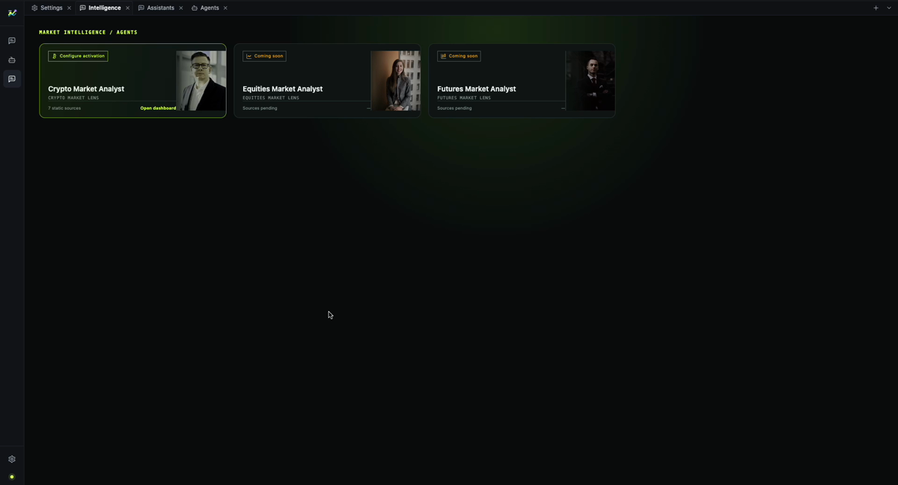
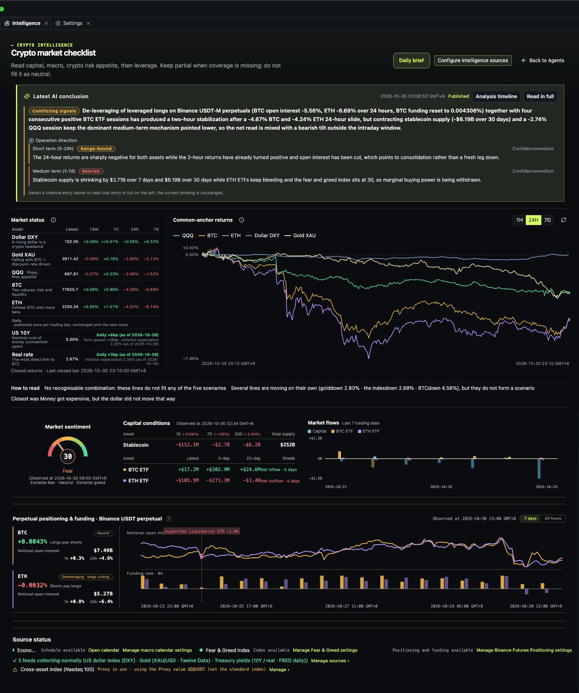
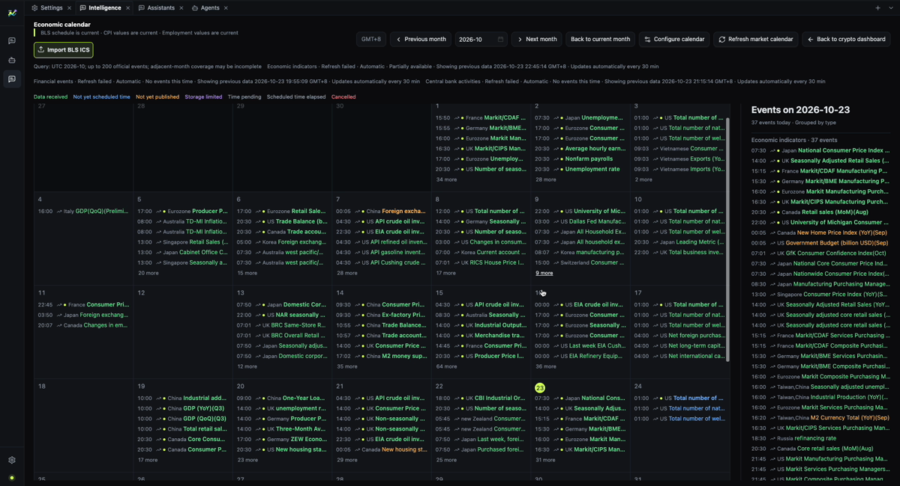

[English](./overview.md) | [中文](./overview.zh-CN.md)

# Product overview

MacroBay answers a simple question: **what changed, and how do you know?**

You open one desktop workspace instead of switching between a news feed, a chart, a macro calendar,
and a chat window. The dashboard shows the current picture; the analyst agent explains it; the
evidence view lets you check the number.

## What you see when you open the app

### Intelligence portal

The portal is the starting point. It shows the available analyst agents and whether their evidence is
ready. From here you open the dashboard, configure data sources, or start a conversation.

### Dashboard

The dashboard groups the market picture into panels:

- macro context;
- cross-asset observations;
- capital conditions;
- the latest published analysis;
- [news sentiment](./news-sentiment.md) — directional judgments for recent text events.

Each panel is backed by the same evidence records the agent uses. A number on the dashboard can be
traced to its source instead of ending at a chart label.

### Macro calendar

The calendar lists scheduled releases and market events. It keeps the schedule identity, the
observation boundary, and later revisions separate, so an updated official value does not rewrite
what was known earlier.

### Analyst agent

The agent works on the selected market or event. It can read the evidence, explain a change, ask a
structured question when a choice matters, and show the tools it used.

## Three concrete use cases

### 1. “What changed this week?”

Open the dashboard, select a market, and ask:

> What changed in the last macro releases, and which assets are most exposed?

A useful answer names the releases, the direction of the change, the affected assets, and the gaps.

### 2. “Why is this number different from yesterday?”

Open the evidence behind a panel and compare the observation time and the cutoff time the query used. If the
source revised the value, the two readings should be distinguishable rather than silently merged.

### 3. “What would change your conclusion?”

Ask the agent for the conditions that would invalidate its view. A good answer describes scenarios
and triggers, not a price prediction.

## What a complete answer contains

- **Facts** with a source reference.
- **Assumptions** the interpretation depends on.
- **Conditions** that would change the conclusion.
- **Gaps** where the evidence is missing.
- **Time boundary** — the observation time and the `asOf` used by the query.

If any of these are missing, the answer is incomplete.

## What it answers, and what it does not

| It is built to answer | It will not answer |
| --- | --- |
| What changed in the last macro release, and which assets does it touch? | Should I buy now? |
| Which readings does this conclusion rest on? | Where is the support level? |
| What would invalidate this interpretation? | What is the price target? |
| What was known at a given time? | What is the chip distribution? |

If your question is about entry timing, levels, chip distribution or order flow, this is the wrong
tool — it does not read charts, and it does not pretend to.

## What the product does not do

- It does not execute trades or manage positions.
- It does not provide unconditional investment advice.
- It does not bundle market data or provider credentials.
- It does not invent a source when evidence is missing.

## Next

- [Analysis workflow](./analysis-workflow.md)
- [Traceability](./traceability.md)
- [Analyst agent](./analyst-agent.md)
