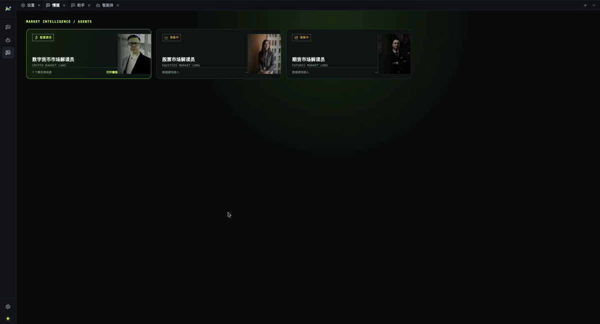
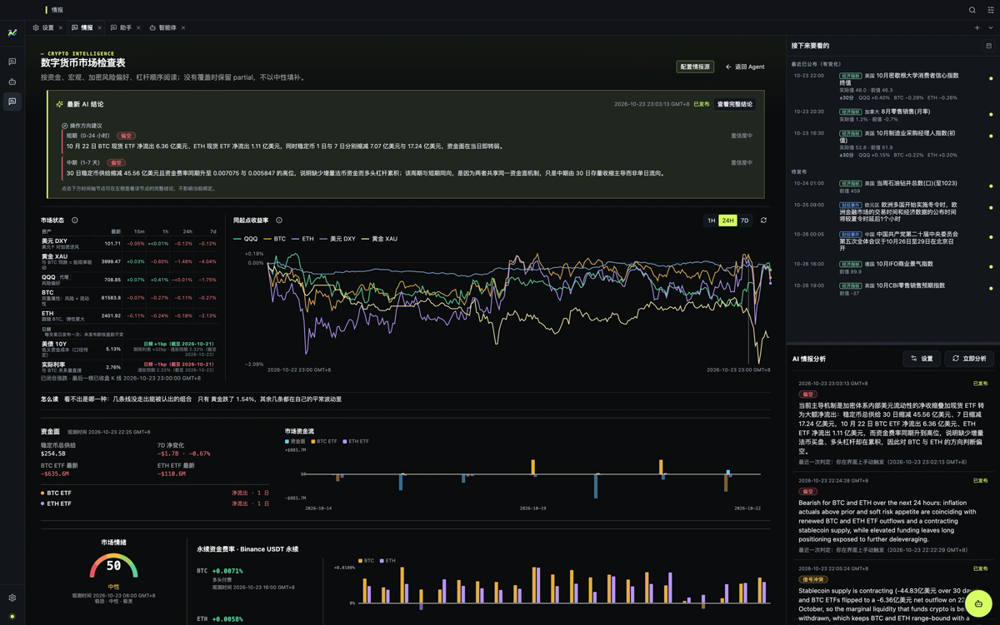
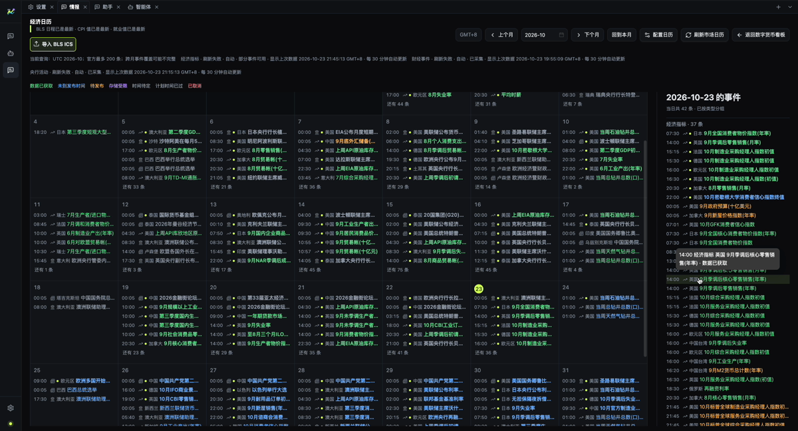

[English](./overview.md) | [中文](./overview.zh-CN.md)

# 产品概览

MacroBay 回答一个很具体的问题：**发生了什么变化，你怎么知道？**

你面对的是一个桌面工作区，而不是新闻流、图表、宏观日历和聊天窗口之间的来回切换。看板给出当前
画面，分析智能体解释变化，证据视图让你核对数字。

## 打开应用会看到什么

### 情报门户

门户是起点，展示可用的分析智能体和证据准备状态。从这里可以打开看板、配置数据源，或开始一次对话。

### 看板

看板把市场画面分成几个面板：

- 宏观背景；
- 跨资产观察；
- 资金条件；
- 最新发布的分析。

每个面板都由智能体使用的同一批证据记录支撑。看板上的数字可以追到来源，而不是停在图表标签上。

### 宏观日历

日历列出发布日程和市场事件，把日程身份、观测边界和后续修订分开保存。官方值更新后，不会悄悄改写
之前已知的版本。

### 分析智能体

智能体围绕选中的市场或事件工作。它可以读取证据、解释变化、在关键选择上提出结构化问题，并展示
使用过的工具。

## 三个具体用法

### 1. “这周发生了什么变化？”

打开看板，选择一个市场，然后问：

> 最近这组宏观数据变化了什么？哪些资产受影响最大？

有用的答案会点名发布项、变化方向、受影响资产和缺口。

### 2. “这个数字为什么和昨天不一样？”

打开面板背后的证据，对比观测时间和查询使用的截止时间。如果来源修订了数值，两个读数应该能区分，而不是
被静默合并。

### 3. “什么情况下你的结论会变？”

让智能体给出会推翻当前判断的条件。好的答案描述情景和触发条件，而不是价格预测。

## 一个完整答案包含什么

- **事实**，带来源引用。
- **假设**，解读依赖的前提。
- **条件**，什么情况下结论会改变。
- **缺口**，证据缺失的地方。
- **时间边界**：观测时间，以及查询使用的 `asOf`。

缺少任何一项，答案都不完整。

## 它不做什么

- 不执行交易，不管理仓位。
- 不提供无条件的投资建议。
- 不内置行情数据或供应商凭据。
- 没有证据时不会编造来源。

## 下一步

- [分析流程](./analysis-workflow.zh-CN.md)
- [可追溯性](./traceability.zh-CN.md)
- [分析智能体](./analyst-agent.zh-CN.md)
